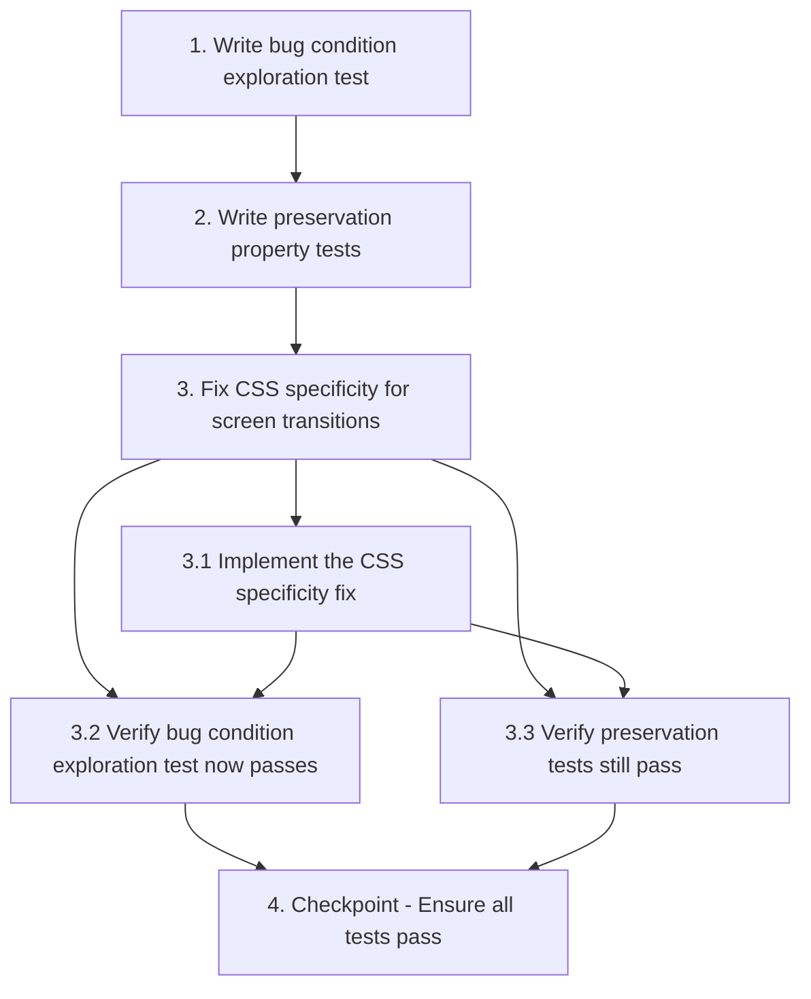

# Implementation Plan

## Overview

This task list implements the CSS specificity fix for the DelNorte login transition bug. The workflow follows the exploratory bugfix methodology: first writing tests to understand the bug (Bug Condition), then capturing existing behavior (Preservation Requirements), then implementing the fix, and finally validating everything works correctly.

## Tasks

- [ ] 1. Write bug condition exploration test
  - **Property 1: Bug Condition** - Screen Transition Display States
  - **CRITICAL**: This test MUST FAIL on unfixed code - failure confirms the bug exists
  - **DO NOT attempt to fix the test or the code when it fails**
  - **NOTE**: This test encodes the expected behavior - it will validate the fix when it passes after implementation
  - **GOAL**: Surface counterexamples that demonstrate the CSS specificity conflict
  - **Scoped PBT Approach**: Test concrete screen transition scenarios (showApp, showLogin) to ensure reproducibility
  - Test that when showApp() is called (active class removed from login-screen, active class added to app-screen), the computed display value for login-screen is "none" and app-screen is "flex"
  - Test that when showLogin() is called (active class added to login-screen, active class removed from app-screen), the computed display value for login-screen is "flex" and app-screen is "none"
  - Use browser DevTools or automated DOM testing to measure computed display styles
  - Test implementation details from Bug Condition in design: isBugCondition checks that class toggles execute but screens don't transition properly
  - The test assertions should match the Expected Behavior: exactly one screen visible with correct display mode
  - Run test on UNFIXED code
  - **EXPECTED OUTCOME**: Test FAILS (this is correct - it proves the CSS specificity bug exists)
  - Document counterexamples found: which screen(s) have incorrect display values and what CSS rules are causing the conflict
  - Mark task complete when test is written, run, and failure is documented
  - _Requirements: 2.1, 2.2_

- [ ] 2. Write preservation property tests (BEFORE implementing fix)
  - **Property 2: Preservation** - Non-Transition Behavior
  - **IMPORTANT**: Follow observation-first methodology
  - Observe behavior on UNFIXED code for non-buggy inputs (all interactions that don't call showApp or showLogin)
  - Observe: Login form interactions (dropdown selection, button enable/disable) work correctly on unfixed code
  - Observe: Navigation and routing within app screen work correctly on unfixed code
  - Observe: All visual styling (colors, spacing, layout of components) renders correctly on unfixed code
  - Observe: Responsive layout behavior at different viewport sizes works correctly on unfixed code
  - Write property-based tests capturing observed behavior patterns from Preservation Requirements
  - Property-based testing generates many test cases for stronger guarantees that non-transition UI is unchanged
  - Test that login form interactions produce same visual results after fix
  - Test that navigation/routing behavior is identical after fix
  - Test that component styling and layout remain unchanged after fix
  - Test that responsive behavior is preserved across viewport sizes
  - Run tests on UNFIXED code
  - **EXPECTED OUTCOME**: Tests PASS (this confirms baseline behavior to preserve)
  - Mark task complete when tests are written, run, and passing on unfixed code
  - _Requirements: 3.1, 3.2, 3.3_

- [ ] 3. Fix CSS specificity for screen transitions

  - [ ] 3.1 Implement the CSS specificity fix
    - Open file: `c:\Users\Reinier\Documents\GitHub\adbio\DelNorte\public\styles\main.css`
    - Increase specificity for base hidden state: Modify screen visibility rules to override ID selectors
    - Add screen-specific active states: Add `#login-screen.active { display: flex; }` and `#app-screen.active { display: flex; }` rules with specificity 1-1-0
    - Remove or scope ID display rules: Remove or scope the `#app-screen { display: flex; }` rule at line 215 to prevent conflicts
    - Add defensive specificity: Add `#login-screen:not(.active), #app-screen:not(.active) { display: none !important; }` to guarantee inactive screens are hidden
    - Verify login screen flexbox: Confirm `#login-screen` includes flexbox properties only when active
    - _Bug_Condition: isBugCondition(input) where input.transitionType == "showApp" AND classToggleExecuted but screens don't transition due to CSS specificity conflict_
    - _Expected_Behavior: exactlyOneScreenVisible(result) AND visibleScreen.displayMode == expectedDisplayMode from design_
    - _Preservation: All non-transition UI behavior must remain unchanged - login form interactions, navigation, component styling, responsive layout_
    - _Requirements: 2.1, 2.2, 3.1, 3.2, 3.3_

  - [ ] 3.2 Verify bug condition exploration test now passes
    - **Property 1: Expected Behavior** - Screen Transition Display States
    - **IMPORTANT**: Re-run the SAME test from task 1 - do NOT write a new test
    - The test from task 1 encodes the expected behavior
    - When this test passes, it confirms the expected behavior is satisfied
    - Run bug condition exploration test from step 1
    - Verify that showApp() now results in login-screen display:none and app-screen display:flex
    - Verify that showLogin() now results in login-screen display:flex and app-screen display:none
    - Use browser DevTools to confirm computed styles match expected values
    - **EXPECTED OUTCOME**: Test PASSES (confirms CSS specificity bug is fixed)
    - _Requirements: Expected Behavior - exactly one screen visible with correct display mode_

  - [ ] 3.3 Verify preservation tests still pass
    - **Property 2: Preservation** - Non-Transition Behavior
    - **IMPORTANT**: Re-run the SAME tests from task 2 - do NOT write new tests
    - Run preservation property tests from step 2
    - Verify login form interactions still work identically
    - Verify navigation and routing behavior unchanged
    - Verify component styling and layout unchanged
    - Verify responsive behavior preserved
    - **EXPECTED OUTCOME**: Tests PASS (confirms no regressions)
    - Confirm all tests still pass after fix (no visual or behavioral regressions)

- [ ] 4. Checkpoint - Ensure all tests pass
  - Manually test the full login flow: Load page → Select user → Click "Start training" → Verify app screen displays and login screen hides
  - Manually test logout flow: Click logout → Confirm dialog → Verify login screen displays and app screen hides
  - Test authenticated page refresh: Authenticate → Refresh page → Verify app screen displays immediately
  - Use browser DevTools to inspect computed styles and confirm CSS specificity is correct
  - Verify no visual regressions in either screen (layout, spacing, colors unchanged)
  - Ensure all automated tests pass
  - Ask the user if questions arise

## Task Dependency Graph



```json
{
  "waves": [
    {
      "name": "Wave 1: Exploration",
      "tasks": ["1"]
    },
    {
      "name": "Wave 2: Preservation",
      "tasks": ["2"]
    },
    {
      "name": "Wave 3: Implementation and Validation",
      "tasks": ["3", "3.1", "3.2", "3.3"]
    },
    {
      "name": "Wave 4: Checkpoint",
      "tasks": ["4"]
    }
  ]
}
```

## Notes

- The bug condition test MUST fail on unfixed code - this confirms the CSS specificity issue exists
- Preservation tests MUST pass on unfixed code - this establishes the baseline behavior to preserve
- The fix involves modifying CSS rules in `main.css` to increase specificity for the screen visibility system
- Use browser DevTools to inspect computed styles and verify CSS specificity during testing
- Property-based testing is recommended for preservation checking to catch edge cases across different viewport sizes and user interactions
