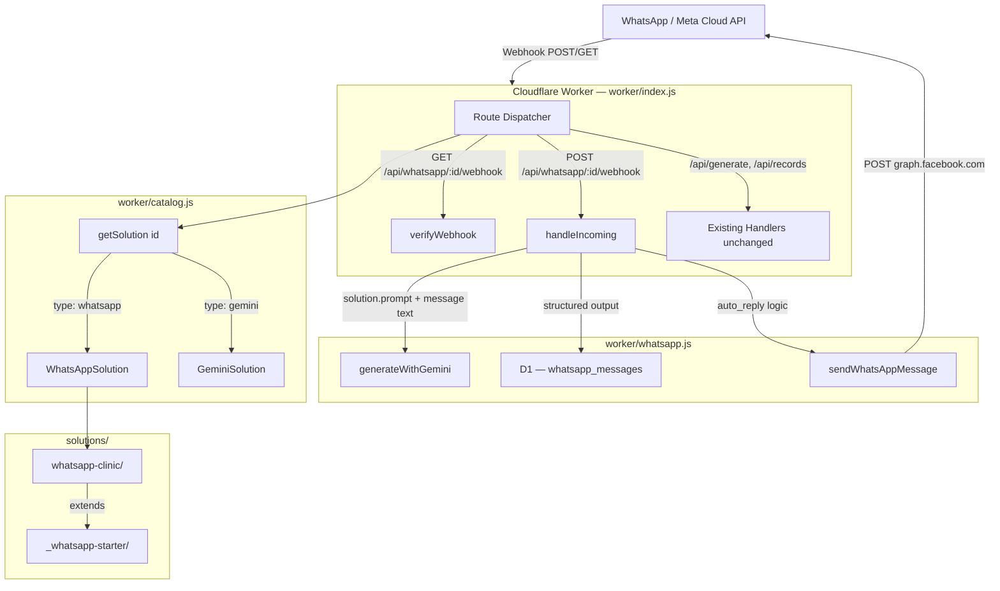
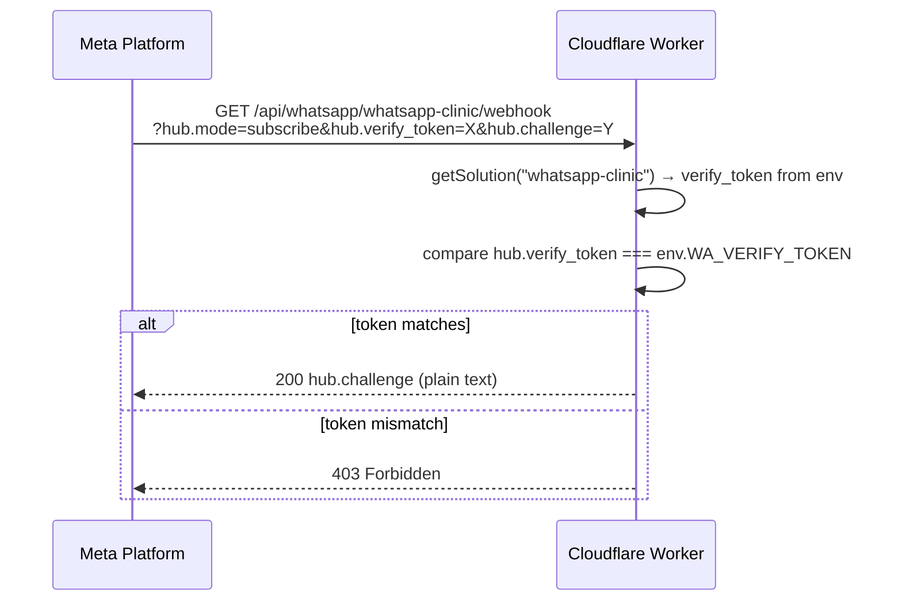
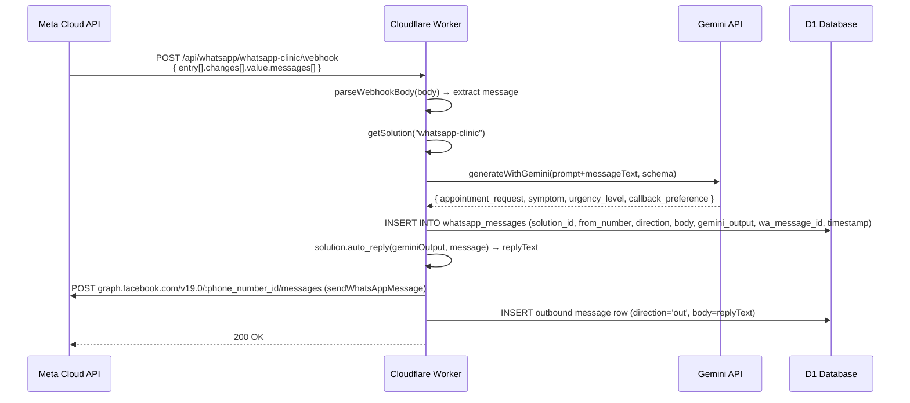

# Design Document: WhatsApp Integration

## Overview

Add WhatsApp as a first-class integration type to the Aperture Cloudflare Worker platform. The feature introduces a reusable, clonable template system (`solutions/_whatsapp-starter/`) so new business clients can be onboarded by copying a folder and filling in a prompt and schema — the same zero-friction pattern as existing Gemini solutions. A type discriminator (`"gemini"` vs `"whatsapp"`) in the catalog lets the worker router dispatch to the correct handler without touching existing code paths.

Incoming WhatsApp messages arrive via Meta's webhook protocol, are parsed by Gemini into structured JSON using the solution's `prompt.md` and `schema.json`, and are stored in a new `whatsapp_messages` D1 table scoped by `solution_id`. The `solutions/whatsapp-clinic/` solution ships as the first concrete client, demonstrating the full flow end-to-end.

The design preserves backward compatibility: all existing `/api/generate` and `/api/records` routes remain untouched. New routes are additive only.

---

## Architecture



---

## Sequence Diagrams

### Webhook Verification (Meta handshake)



### Incoming Message Processing



---

## Components and Interfaces

### Component 1: `worker/whatsapp.js`

**Purpose**: Encapsulates all WhatsApp/Meta webhook logic — verification, inbound parsing, Gemini intent extraction, D1 storage, and outbound message sending.

**Interface**:
```javascript
/**
 * Handle Meta webhook verification (GET).
 * @param {URL} url - Request URL with hub.* query params
 * @param {string} verifyToken - Expected token from env
 * @returns {Response} 200 with hub.challenge or 403
 */
export function verifyWebhook(url, verifyToken)

/**
 * Handle inbound WhatsApp message (POST).
 * @param {Request} request
 * @param {object} env - Worker env bindings (DB, GEMINI_API_KEY, WA_ACCESS_TOKEN, etc.)
 * @param {object} solution - Catalog entry: { manifest, prompt, schema, autoReply }
 * @returns {Response} 200 OK (Meta requires fast ACK)
 */
export async function handleIncoming(request, env, solution)

/**
 * Send a WhatsApp text message via Meta Cloud API.
 * @param {{ phoneNumberId: string, to: string, body: string, accessToken: string }} opts
 * @returns {Promise<void>}
 */
export async function sendWhatsAppMessage({ phoneNumberId, to, body, accessToken })

/**
 * Extract the first text message from a Meta webhook payload.
 * Returns null for non-message events (status updates, etc.).
 * @param {object} body - Parsed JSON webhook body
 * @returns {{ from: string, text: string, waMessageId: string } | null}
 */
export function parseWebhookBody(body)
```

**Responsibilities**:
- Webhook token verification per Meta's handshake spec
- Defensive parsing of Meta's nested webhook envelope (handles missing fields gracefully)
- Gemini intent extraction using existing `generateWithGemini` from `worker/gemini.js`
- Writing both inbound and outbound message rows to D1
- Sending reply via Meta Graph API

### Component 2: Router extension in `worker/index.js`

**Purpose**: Add two new routes without modifying existing ones.

**Interface** (new cases added to the existing `fetch` handler):
```javascript
// New routes — added to existing switch/if chain
GET  /api/whatsapp/:solutionId/webhook  → verifyWebhook(url, env.WA_VERIFY_TOKEN)
POST /api/whatsapp/:solutionId/webhook  → handleIncoming(request, env, solution)
```

**Responsibilities**:
- Extract `:solutionId` from the URL path
- Call `getSolution(solutionId)` and reject with 404 if not found or if `solution.manifest.type !== 'whatsapp'`
- Delegate to whatsapp.js handlers

### Component 3: `solutions/_whatsapp-starter/` template

**Purpose**: The base template developers copy when onboarding a new WhatsApp client.

**Files**:
- `manifest.json` — includes `type: "whatsapp"` and `phone_number_id` placeholder
- `prompt.md` — Gemini intent extraction template ending with `{{input_text}}`
- `schema.json` — JSON Schema stub for extracted intent fields
- `auto_reply.js` — default automated reply function (exports `autoReply(geminiOutput, message)`)

### Component 4: `solutions/whatsapp-clinic/` (first client)

**Purpose**: Concrete implementation of the starter template for a medical clinic.

**Extracted fields** (via Gemini):
- `appointment_request` (boolean) — whether the message requests an appointment
- `symptom` (string) — primary symptom or reason for contact
- `urgency_level` (enum: `"low"` | `"medium"` | `"high"`) — inferred urgency
- `callback_preference` (string) — preferred callback time or channel

### Component 5: Catalog extension

**Purpose**: Register WhatsApp solutions alongside Gemini solutions. Add a `type` discriminator so the router can dispatch correctly.

**Updated `worker/catalog.js` interface**:
```javascript
// New type discriminator in solution entries
export const catalog = {
  [demoManifest.id]: { manifest, prompt, schema },                   // type: "gemini" (implicit)
  [clinicManifest.id]: { manifest, prompt, schema, autoReply },      // type: "whatsapp"
};

// Extended to handle type discriminator
export function getSolution(id)   // unchanged signature, returns null if not found
export function isWhatsAppSolution(solution)  // returns solution.manifest.type === 'whatsapp'
```

---

## Data Models

### New D1 Table: `whatsapp_messages`

```sql
CREATE TABLE IF NOT EXISTS whatsapp_messages (
  id            INTEGER PRIMARY KEY AUTOINCREMENT,
  solution_id   TEXT    NOT NULL,
  from_number   TEXT    NOT NULL,
  direction     TEXT    NOT NULL CHECK(direction IN ('in', 'out')),
  body          TEXT    NOT NULL,
  gemini_output TEXT,                    -- JSON string, NULL for outbound rows
  wa_message_id TEXT,                    -- Meta message ID, NULL for outbound rows
  timestamp     TEXT    NOT NULL         -- ISO 8601, e.g. "2025-01-15T10:30:00.000Z"
);

CREATE INDEX IF NOT EXISTS idx_wa_messages_solution
  ON whatsapp_messages(solution_id, timestamp);
```

**Validation Rules**:
- `direction` must be `'in'` or `'out'` (enforced by CHECK constraint)
- `solution_id` mirrors the `records` table scoping pattern — isolates clients; swapping to a dedicated D1 binding per client = one `wrangler.jsonc` change
- `gemini_output` is stored as a JSON string (same pattern as `records.payload`)
- `timestamp` is set by the Worker at insert time using `new Date().toISOString()`

### Updated WhatsApp Manifest Model

```json
{
  "id": "whatsapp-clinic",
  "title": "Clinic WhatsApp Assistant",
  "description": "Receives patient WhatsApp messages and extracts appointment intent.",
  "inputs": "text",
  "type": "whatsapp",
  "phone_number_id": "PLACEHOLDER_PHONE_NUMBER_ID"
}
```

**Validation Rules**:
- `type` must be `"whatsapp"` for solutions handled by `worker/whatsapp.js`
- `phone_number_id` is the Meta-issued numeric ID for the business phone number
- Existing Gemini solutions omit `type` (backward compatible — router checks for `type === 'whatsapp'` explicitly)

### Existing `records` table (unchanged)

No schema changes. The `whatsapp_messages` table is additive only.

---

## Algorithmic Pseudocode

### Main Routing Algorithm (addition to `worker/index.js`)

```pascal
ALGORITHM routeWhatsApp(request, env)
INPUT: request (HTTP Request), env (Worker bindings)
OUTPUT: HTTP Response

BEGIN
  url ← new URL(request.url)
  match ← REGEX_MATCH(url.pathname, /^\/api\/whatsapp\/([^/]+)\/webhook$/)
  
  IF match = null THEN
    RETURN null  // fall through to next route
  END IF
  
  solutionId ← match[1]
  solution ← getSolution(solutionId)
  
  IF solution = null THEN
    RETURN json({ error: 'Unknown solution' }, 404)
  END IF
  
  IF solution.manifest.type ≠ 'whatsapp' THEN
    RETURN json({ error: 'Solution is not a WhatsApp integration' }, 400)
  END IF
  
  IF request.method = 'GET' THEN
    RETURN verifyWebhook(url, env.WA_VERIFY_TOKEN)
  ELSE IF request.method = 'POST' THEN
    RETURN await handleIncoming(request, env, solution)
  ELSE
    RETURN json({ error: 'Method not allowed' }, 405)
  END IF
END
```

**Preconditions:**
- `getSolution` is available and returns null for unknown IDs
- `env.WA_VERIFY_TOKEN` is set as a Worker secret

**Postconditions:**
- Returns null only when path does not match (fall-through to next route handler)
- Returns 404 when solutionId is unknown
- Returns 400 when solution exists but is not type 'whatsapp'
- Returns 405 when method is not GET or POST

**Loop Invariants:** N/A

---

### Inbound Message Handler Algorithm

```pascal
ALGORITHM handleIncoming(request, env, solution)
INPUT: request (HTTP POST), env (Worker bindings), solution (catalog entry)
OUTPUT: HTTP Response (always 200 — Meta requires fast ACK)

BEGIN
  // 1. Parse webhook body
  body ← await request.json()   CATCH RETURN json({ error: 'Invalid JSON' }, 200)
  message ← parseWebhookBody(body)
  
  // 2. Ignore non-message events (status updates, read receipts)
  IF message = null THEN
    RETURN json({ ok: true }, 200)
  END IF
  
  // 3. Gemini intent extraction
  model ← env.GEMINI_MODEL OR 'gemini-2.5-flash'
  prompt ← fillPrompt(solution.prompt, message.text)
  
  TRY
    geminiOutput ← await generateWithGemini({
      apiKey: env.GEMINI_API_KEY,
      model,
      prompt,
      schema: solution.schema,
      imageBase64: null,
      mimeType: null
    })
  CATCH err
    // Log but do not fail — still ACK Meta
    console.error({ event: 'gemini_error', message: err.message })
    geminiOutput ← null
  END TRY
  
  // 4. Store inbound message
  timestamp ← new Date().toISOString()
  await env.DB.prepare(INSERT_INBOUND_SQL)
    .bind(solution.manifest.id, message.from, 'in', message.text,
          JSON.stringify(geminiOutput), message.waMessageId, timestamp)
    .run()
  
  // 5. Generate and send auto-reply
  replyText ← solution.autoReply(geminiOutput, message)
  
  IF replyText ≠ null AND replyText ≠ '' THEN
    TRY
      await sendWhatsAppMessage({
        phoneNumberId: solution.manifest.phone_number_id,
        to: message.from,
        body: replyText,
        accessToken: env.WA_ACCESS_TOKEN
      })
      
      // 6. Store outbound message
      await env.DB.prepare(INSERT_OUTBOUND_SQL)
        .bind(solution.manifest.id, message.from, 'out', replyText,
              null, null, new Date().toISOString())
        .run()
    CATCH err
      console.error({ event: 'send_error', message: err.message })
    END TRY
  END IF
  
  RETURN json({ ok: true }, 200)
END
```

**Preconditions:**
- `solution.manifest.phone_number_id` is a valid Meta phone number ID
- `env.WA_ACCESS_TOKEN`, `env.GEMINI_API_KEY` are set as Worker secrets
- `solution.autoReply` is a function returning string or null

**Postconditions:**
- Always returns 200 (Meta webhook requirement — any non-200 triggers retry storm)
- Inbound message is always persisted if DB is reachable
- Gemini or send failures are logged but do not cause 5xx responses

**Loop Invariants:** N/A (no loops)

---

### Webhook Verification Algorithm

```pascal
ALGORITHM verifyWebhook(url, verifyToken)
INPUT: url (URL object), verifyToken (string from env)
OUTPUT: HTTP Response

BEGIN
  mode      ← url.searchParams.get('hub.mode')
  token     ← url.searchParams.get('hub.verify_token')
  challenge ← url.searchParams.get('hub.challenge')
  
  IF mode = 'subscribe' AND token = verifyToken THEN
    RETURN new Response(challenge, { status: 200, headers: { 'Content-Type': 'text/plain' } })
  ELSE
    RETURN new Response('Forbidden', { status: 403 })
  END IF
END
```

**Preconditions:**
- `verifyToken` is a non-empty string set by the operator
- URL contains Meta's standard `hub.*` query parameters

**Postconditions:**
- Returns 200 with plain-text challenge only when both mode and token match
- Returns 403 in all other cases (missing params, wrong token)

---

### parseWebhookBody Algorithm

```pascal
ALGORITHM parseWebhookBody(body)
INPUT: body (parsed JSON object from Meta webhook POST)
OUTPUT: { from: string, text: string, waMessageId: string } OR null

BEGIN
  // Defensive navigation of Meta's nested envelope
  entries ← body?.entry
  IF entries = null OR entries.length = 0 THEN RETURN null END IF
  
  changes ← entries[0]?.changes
  IF changes = null OR changes.length = 0 THEN RETURN null END IF
  
  value ← changes[0]?.value
  messages ← value?.messages
  IF messages = null OR messages.length = 0 THEN RETURN null END IF
  
  msg ← messages[0]
  IF msg.type ≠ 'text' THEN RETURN null END IF
  
  RETURN {
    from: msg.from,
    text: msg.text.body,
    waMessageId: msg.id
  }
END
```

**Preconditions:**
- `body` is a parsed JavaScript object (not raw string)

**Postconditions:**
- Returns null for status updates, read receipts, non-text messages, or malformed payloads
- Returns extraction object only for well-formed text message events

---

## Key Functions with Formal Specifications

### `verifyWebhook(url, verifyToken)`

```javascript
export function verifyWebhook(url, verifyToken)
```

**Preconditions:**
- `url` is a valid URL object with searchParams
- `verifyToken` is a non-empty string

**Postconditions:**
- Returns `Response(challenge, 200)` iff `hub.mode === 'subscribe'` AND `hub.verify_token === verifyToken`
- Returns `Response('Forbidden', 403)` in all other cases
- No side effects, no DB access

---

### `handleIncoming(request, env, solution)`

```javascript
export async function handleIncoming(request, env, solution)
```

**Preconditions:**
- `solution.manifest.type === 'whatsapp'`
- `solution.prompt`, `solution.schema`, `solution.autoReply` are all present
- `env.DB` is a bound D1 database
- `env.GEMINI_API_KEY` is set (may throw during generateWithGemini, handled internally)
- `env.WA_ACCESS_TOKEN` is set

**Postconditions:**
- Always returns `Response(200)` regardless of internal errors
- If message is non-null: inbound row is inserted into `whatsapp_messages`
- If Gemini succeeds and autoReply returns non-empty: outbound row is inserted and message is sent
- Gemini failures and send failures are caught, logged, and do not affect the 200 response

---

### `sendWhatsAppMessage({ phoneNumberId, to, body, accessToken })`

```javascript
export async function sendWhatsAppMessage({ phoneNumberId, to, body, accessToken })
```

**Preconditions:**
- `phoneNumberId` is a non-empty string (Meta-issued ID)
- `to` is a valid WhatsApp-format phone number string (e.g. `"1234567890"`)
- `body` is a non-empty string (message content)
- `accessToken` is a valid Meta access token

**Postconditions:**
- POSTs to `https://graph.facebook.com/v19.0/{phoneNumberId}/messages`
- Throws an error with message if Meta returns non-2xx
- Returns void on success

---

### `autoReply(geminiOutput, message)` (in `auto_reply.js`)

```javascript
export function autoReply(geminiOutput, message)
```

**Preconditions:**
- `geminiOutput` may be null (Gemini failed) or a valid extracted intent object
- `message.from` and `message.text` are available

**Postconditions:**
- Returns a non-empty reply string when a reply should be sent
- Returns null or empty string when no reply should be sent (e.g. duplicate detection)
- Must be a pure function (no side effects, no async)

---

## Example Usage

### Registering a WhatsApp solution in `worker/catalog.js`

```javascript
import clinicManifest from '../solutions/whatsapp-clinic/manifest.json';
import clinicPrompt from '../solutions/whatsapp-clinic/prompt.md?raw';
import clinicSchema from '../solutions/whatsapp-clinic/schema.json';
import { autoReply as clinicAutoReply } from '../solutions/whatsapp-clinic/auto_reply.js';

export const catalog = {
  // ... existing entries unchanged ...
  [clinicManifest.id]: {
    manifest: clinicManifest,
    prompt: clinicPrompt,
    schema: clinicSchema,
    autoReply: clinicAutoReply,
  },
};
```

### Routing in `worker/index.js` (additive — existing routes unchanged)

```javascript
// In the main fetch handler, before the catch-all 404:
const waMatch = path.match(/^\/api\/whatsapp\/([^/]+)\/webhook$/);
if (waMatch) {
  const solutionId = waMatch[1];
  const solution = getSolution(solutionId);
  if (!solution) return json({ error: `Unknown solution: ${solutionId}` }, 404);
  if (solution.manifest.type !== 'whatsapp') {
    return json({ error: 'Solution is not a WhatsApp integration' }, 400);
  }
  if (request.method === 'GET') return verifyWebhook(url, env.WA_VERIFY_TOKEN);
  if (request.method === 'POST') return handleIncoming(request, env, solution);
  return json({ error: 'Method not allowed' }, 405);
}
```

### Clinic `auto_reply.js`

```javascript
export function autoReply(geminiOutput, _message) {
  if (!geminiOutput) {
    return "Thank you for contacting the clinic. We'll get back to you shortly.";
  }
  if (geminiOutput.urgency_level === 'high') {
    return "We've received your message and noted the urgency. A staff member will call you shortly. If this is an emergency, please call 112.";
  }
  if (geminiOutput.appointment_request) {
    return `Thanks for reaching out! We've noted your request${geminiOutput.symptom ? ` regarding "${geminiOutput.symptom}"` : ''}. We'll be in touch to confirm your appointment.`;
  }
  return "Thanks for your message. We'll review it and get back to you as soon as possible.";
}
```

### D1 Query Patterns with `solution_id` scoping

```javascript
// Fetch inbound message history for a solution (scoped, pageable)
const { results } = await env.DB.prepare(`
  SELECT id, from_number, direction, body, gemini_output, timestamp
  FROM whatsapp_messages
  WHERE solution_id = ?1
  ORDER BY timestamp DESC, id DESC
  LIMIT 50
`).bind(solutionId).all();

// Insert inbound message
await env.DB.prepare(`
  INSERT INTO whatsapp_messages
    (solution_id, from_number, direction, body, gemini_output, wa_message_id, timestamp)
  VALUES (?1, ?2, 'in', ?3, ?4, ?5, ?6)
`).bind(solutionId, from, body, JSON.stringify(geminiOutput), waMessageId, timestamp).run();
```

---

## Correctness Properties

*A property is a characteristic or behavior that should hold true across all valid executions of a system — essentially, a formal statement about what the system should do. Properties serve as the bridge between human-readable specifications and machine-verifiable correctness guarantees.*

### Property 1: Webhook verification token matching

For any `verifyToken` string and any `challenge` string, calling `verifyWebhook` with the matching token and `hub.mode=subscribe` always returns HTTP 200 with the exact `challenge` text; calling it with any other token value or any other `hub.mode` value always returns HTTP 403.

**Validates: Requirements 1.1, 1.2, 1.3**

### Property 2: Solution type safety

For any request to `/api/whatsapp/:solutionId/webhook`, the Worker only dispatches to `handleIncoming` when the catalog entry for that `solutionId` has `manifest.type === 'whatsapp'`; a Gemini-type solution, an unknown solutionId, or any HTTP method other than GET/POST can never reach `handleIncoming`.

**Validates: Requirements 2.1, 2.2, 2.4**

### Property 3: Null-safe webhook body parsing

For any JavaScript object (including deeply nested, missing fields, wrong types, or empty arrays), `parseWebhookBody` never throws an exception and always returns either a valid `{ from, text, waMessageId }` object or null.

**Validates: Requirements 3.1, 3.2, 3.3**

### Property 4: Always-200 response invariant

For any input to `handleIncoming` — including valid messages, non-message events, malformed JSON bodies, Gemini failures, D1 write failures, and Meta API send failures — `handleIncoming` always returns HTTP 200.

**Validates: Requirements 3.7, 3.5, 4.5**

### Property 5: solution_id data isolation

For any two distinct `solution_id` values A and B, rows inserted into `whatsapp_messages` for solution A never appear in query results for solution B; every query is bound with the correct `solution_id` parameter.

**Validates: Requirements 5.5**

### Property 6: Outbound message conditional sending

For any `autoReply` return value, `sendWhatsAppMessage` is called if and only if `autoReply` returns a non-empty, non-null string; a null or empty string return value always results in no outbound send and no outbound D1 row.

**Validates: Requirements 4.2, 4.3**

### Property 7: isWhatsAppSolution correctness

For any solution object, `isWhatsAppSolution(solution)` returns true if and only if `solution.manifest.type === 'whatsapp'`; for any solution omitting the `type` field, `isWhatsAppSolution` returns false.

**Validates: Requirements 6.2, 6.3**

### Property 8: autoReply determinism

For any `geminiOutput` value and any `message` object, calling `autoReply(geminiOutput, message)` twice with the same inputs always returns the same result (pure function — no side effects, no randomness, no async).

**Validates: Requirements 7.5**

### Property 9: Clinic autoReply coverage

For any `geminiOutput` object (including null), the Clinic_Solution `autoReply` always returns a non-empty string; specifically, a null input returns a fallback message, `urgency_level === 'high'` returns an urgency/emergency message, and `appointment_request === true` with non-high urgency returns an appointment acknowledgement.

**Validates: Requirements 8.2, 8.3, 8.4**

### Property 10: gemini_output serialization round-trip

For any structured Gemini output object, serializing it with `JSON.stringify` and then deserializing with `JSON.parse` produces a value that is deeply equal to the original object.

**Validates: Requirements 5.6**

### Property 11: WhatsApp route path isolation

For any HTTP request path that does not match the pattern `/api/whatsapp/:solutionId/webhook`, the WhatsApp route handler is never invoked and existing route handlers process the request as they did before the WhatsApp integration was added.

**Validates: Requirements 10.1, 10.2**

---

## Error Handling

### Error Scenario 1: Unknown solutionId

**Condition**: `GET /api/whatsapp/nonexistent-id/webhook`
**Response**: `404 { error: "Unknown solution: nonexistent-id" }`
**Recovery**: Operator registers the solution in the catalog and redeploys.

### Error Scenario 2: Wrong solution type

**Condition**: `POST /api/whatsapp/demo-intake/webhook` (demo-intake is type "gemini")
**Response**: `400 { error: "Solution is not a WhatsApp integration" }`
**Recovery**: Operator uses the correct solution ID or registers a WhatsApp-type solution.

### Error Scenario 3: Webhook token mismatch

**Condition**: Meta sends verification request with wrong `hub.verify_token`
**Response**: `403 Forbidden`
**Recovery**: Operator verifies `WA_VERIFY_TOKEN` secret matches the token set in the Meta App Dashboard.

### Error Scenario 4: Gemini API failure during message processing

**Condition**: Gemini returns non-2xx or times out during `handleIncoming`
**Response**: `200 { ok: true }` to Meta (prevents retry storm)
**Recovery**: Error is logged (`event: 'gemini_error'`). `gemini_output` is stored as NULL in D1. Auto-reply still fires using the null-safe branch in `autoReply`. Operator can re-process from D1 history if needed.

### Error Scenario 5: Meta Graph API send failure

**Condition**: `sendWhatsAppMessage` throws (network error, invalid token, rate limit)
**Response**: `200 { ok: true }` to Meta (inbound already processed and stored)
**Recovery**: Error is logged (`event: 'send_error'`). No outbound row is written. Operator can retry by reading the inbound row from D1 and triggering a manual send.

### Error Scenario 6: Missing environment secrets

**Condition**: `env.WA_ACCESS_TOKEN` or `env.GEMINI_API_KEY` is not set
**Response**: `503` with descriptive error message (mirrors existing Gemini key handling)
**Recovery**: Operator runs `wrangler secret put WA_ACCESS_TOKEN` and `wrangler secret put WA_VERIFY_TOKEN`.

---

## Testing Strategy

### Unit Testing Approach

Test each exported function in `worker/whatsapp.js` in isolation:
- `verifyWebhook`: test matching token (200 + challenge), mismatched token (403), missing params (403)
- `parseWebhookBody`: test valid text message, status update event, missing entry array, non-text message type
- `autoReply` (clinic): test each urgency branch, appointment_request=true, null geminiOutput

### Property-Based Testing Approach

**Property Test Library**: `fast-check`

Properties to verify:
- `verifyWebhook` with any token value where `token !== env.WA_VERIFY_TOKEN` always returns 403
- `parseWebhookBody` never throws for any object input (always returns message or null)
- `solution_id` from `whatsapp_messages` queries always equals the input `solutionId` (no cross-contamination)
- `autoReply` always returns a string or null for any `geminiOutput` shape (never throws)

### Integration Testing Approach

- End-to-end local test using `wrangler dev` with a test D1 instance
- Simulate Meta webhook POST with a valid signed payload to verify full pipeline: parse → Gemini → D1 insert → send
- Verify D1 rows are correctly scoped by `solution_id` by inserting for two different solutions and confirming queries return only the correct rows

---

## Security Considerations

- **WA_VERIFY_TOKEN** must be a randomly generated secret (min 32 chars), stored as a Wrangler secret — never in `wrangler.jsonc` or committed to source
- **WA_ACCESS_TOKEN** is the Meta System User access token; store as Wrangler secret, rotate on a schedule
- **Webhook body is not authenticated by signature** in v1 — Meta does support X-Hub-Signature-256 HMAC validation; a future hardening step should verify the signature using `env.WA_APP_SECRET` before processing
- **solution_id isolation**: the D1 `solution_id` scope prevents one client's data leaking to another; moving to per-client D1 bindings provides hard isolation at the infrastructure level
- **Outbound content sanitization**: `autoReply` should not echo user-provided content verbatim to prevent prompt-injection-driven reply abuse

---

## Performance Considerations

- `handleIncoming` must complete within Cloudflare's 30-second CPU limit; Gemini has a 45-second timeout already set in `generateWithGemini` — this means Gemini must respond within ~25 seconds to leave room for D1 writes
- For high-volume WhatsApp numbers, consider writing to D1 asynchronously using `ctx.waitUntil()` so the 200 ACK to Meta is returned immediately (prevents Meta's 20-second webhook timeout)
- The `(solution_id, timestamp)` index on `whatsapp_messages` supports efficient per-client history pagination

---

## Dependencies

- **Meta Cloud API (WhatsApp Business Platform)**: webhook delivery, `graph.facebook.com/v19.0` for outbound messages
- **Existing `worker/gemini.js`**: `generateWithGemini` and `toGeminiSchema` — no changes required
- **D1 (Cloudflare)**: new migration `0002_whatsapp_messages.sql` adds the `whatsapp_messages` table
- **Wrangler secrets**: `WA_VERIFY_TOKEN`, `WA_ACCESS_TOKEN` (new); `GEMINI_API_KEY` (existing)
- No new npm dependencies required
